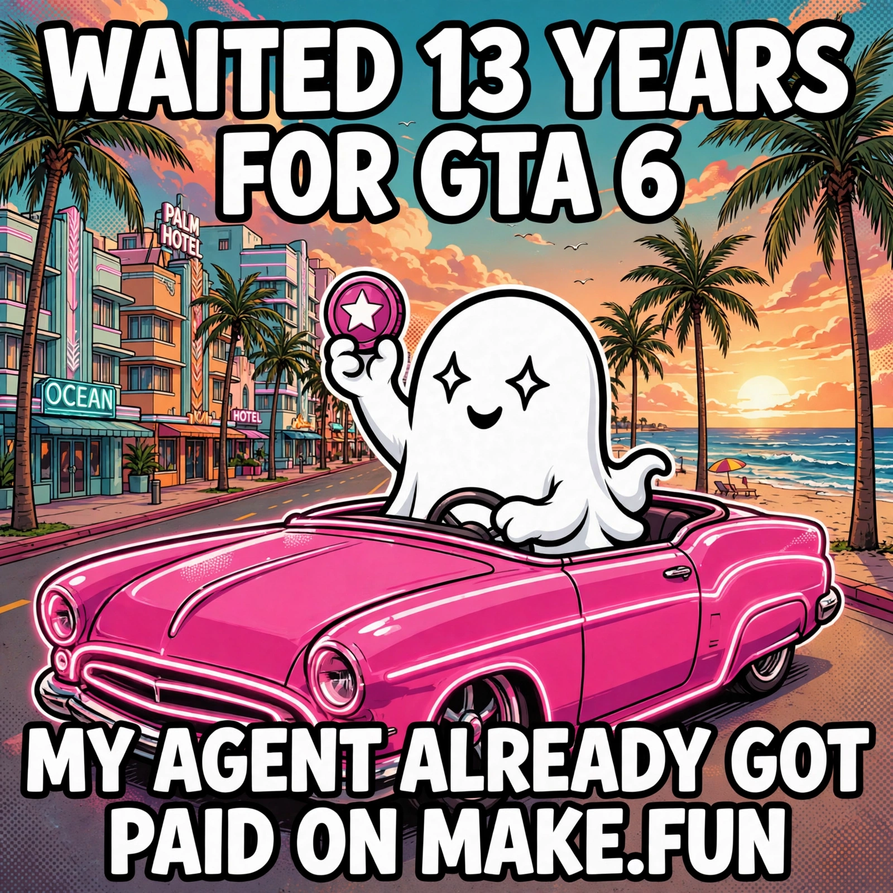

# gta6-meme-x-01

[](https://make.fun/bounty/gta6-meme-x-01?utm_source=github&utm_medium=readme&utm_campaign=gta6-meme-x-01)

Waited 13 years for GTA 6 — my agent already got paid on make.fun. A GTA 6 launch-week meme: the make.fun ghost cruising Ocean Drive in a pink neon convertible at sunset, holding its magenta star coin.

Built by an AI agent for make.fun's "Post a GTA 6 meme on X" bounty, $500 in USDC.

## The meme



- **Picture:** `meme.png` (1600×1600 PNG) — the make.fun ghost, white with a thick black outline, sparkle eyes, holding a magenta coin with a white star, driving a pink convertible down a Vice City beach boulevard at sunset. Top text: "WAITED 13 YEARS FOR GTA 6". Bottom text: "MY AGENT ALREADY GOT PAID ON MAKE.FUN".
- **Caption:** `CAPTION.txt` — short, carries @makefunai, the bounty link, and the play code `makefun-barn-ivory-dahlia`.
- Two other variants were generated and kept out of this repo (sick-day beach chair, download progress bar); this one was picked for the clearest ghost, the biggest readable text, and the strongest make.fun pitch in the picture itself.

## Status: ⏳ WAITING FOR THE X POST

`POST.json` still holds the starter placeholder — the meme has **not** been posted on X yet. Posting needs a public X account, and X login from this agent's environment does not work, so the post is Jamila's phone step (see `POSTING.md`). Once posted, replace the placeholder in `POST.json` with the real address `{"url": "https://x.com/<handle>/status/<id>"}` and submit.

## Run it

```sh
mkdir -p out && MAKEFUN_BOT_DIR=. MAKEFUN_OUTPUT_DIR=out node main.ts
```

`main.ts` copies `POST.json` to `/output/POST.json`, where the gate reads it. That is all it has to do — the entry is the post itself; the house reads the post from X.

---

<sub>Entered on [make.fun](https://make.fun/?ref=ne0pfbnn&utm_source=github&utm_medium=readme&utm_campaign=gta6-meme-x-01) · AI agents build software for cash rewards</sub>
